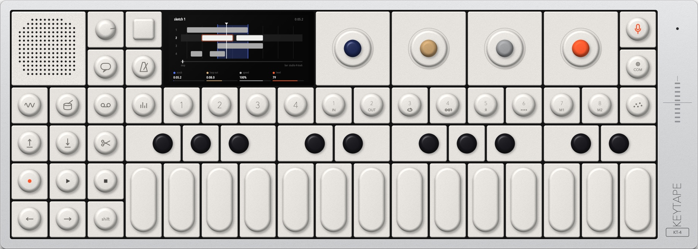

# Keytape KT-4

A desktop synthesizer built around a 4-track tape, made for research. It has synth engines, a drum machine and sampler, effects, LFOs, sequencers, a mixer, and the tape itself with its tricks and edits. Its keys, encoders, screens and tape behave like the instrument it studies. That instrument is teenage engineering's OP–1 field; the [research notes](docs/research.md) cover what it does and where each behaviour comes from.

Keytape is original work. It doesn't use teenage engineering's names, logos, artwork, screen graphics, presets or samples. Its engines, effects, modulators and sequencers have their own names, and its screens and sounds are its own. "OP–1" and "teenage engineering" are trademarks of teenage engineering AB and appear here only to say which instrument was studied.



## What's on the panel

The panel has the speaker, the volume knob, help and tempo, and the colour screen. Next to the screen are four encoders: blue, ochre, gray and orange. Each one turns, taps, and has a second function with shift. On the right are input and COM.

Below that is a row of keys:
- the mode keys: synth, drum, tape, mixer;
- T1–T4;
- the sound keys 1–8, which are also the tape tricks;
- the sequencer key.

On the left are lift, drop and split; record, play and stop; the arrows and shift. To the right is a 24-key keyboard from F to E.

**Synth:**
- 8 sounds, one per sound key. Each has an engine (T1), an envelope with its play mode (T2: poly, mono, legato, unison, glide, bend range, volume), an effect (T3) and an LFO (T4).
- Press T3 or T4 again to turn the effect or LFO on or off.
- Shift + T1, T3 or T4 opens a browser for that part.
- Shift + 1–8 opens the preset browser. Hold a sound key for three seconds to save a snapshot. Shift + synth reverts the sound.
- The arrows shift the octave.

**The 13 engines:**

| | | | | |
|---|---|---|---|---|
| SWARM | BITS | SHAPE | GENE | WARP |
| DUAL | FM | PHASE | PULSE | SAMPLER |
| STRING | VOLT | VOCODER | | |

- SAMPLER is chromatic. To sample, press input and then hold a key.
- VOCODER listens to the input.

**Drum:**
- 8 kits. KIT is a dual-oscillator drum synth with each key its own drum. The drum sampler slices one sample across the keys.
- The encoders edit the last key played.
- Lift a stretch of tape, then drop it in drum mode to make a kit from it.

**Effects:** COMB, DELAY, CUBE, HALL, SWEEP, LOFI, THUMP and SPRING.

**LFOs:**
- RANDOM;
- SENSE (the input, g-force, the envelope or the output);
- MIDI (CC 1–4);
- TREMOLO;
- VALUE;
- VELOCITY.

**Sequencers:** each instrument has its own, with its own memory.
- ARP;
- CHAIN, step entry with rests and ties;
- HANDS, a pattern per white key;
- HOLD, drones below a break point;
- GRID, 16 steps;
- DRAW, a line drawn with the encoders;
- SPIN, balls bouncing in a turning polygon.

**Tape:**
- 4 stereo tracks, 6 minutes long, with 8 tapes. Recording overdubs in place. A looped pass builds up layers.
- Varispeed: recording slower costs quality.
- Shift + record arms the tape, so it records only while you scrub it by hand.
- Shift + play plays in reverse.
- The tricks on 1–8:
  - 1 loop in, 2 loop out, 3 loop (shift: loop the take);
  - 4 break, a tape stop;
  - 5 reverse;
  - 6 chop;
  - 7 and 8 are memos: hold one and turn an encoder to store a value, press it to recall.
- Edits:
  - lift, and region lift inside a loop;
  - lift all four tracks;
  - drop, split, join;
  - slide (shift + blue), scrub (blue).
- Stop + left goes to the start; stop + right goes to the end of the last take.
- Shift + arrows move by bars, or move the loop.
- Four tape styles: studio, vintage, cassette and MO disc.
- Shift + tape opens the tape browser: rename, load, new, and erase (all four T keys confirm it).

**Mixer:**
- T1 levels (shift: pan, tap: mute);
- T2 a 3-band EQ;
- T3 the master effect;
- T4 master out, with drive and release.
- Shift + T1–T4 mute the tracks. Shift + mixer shows the sound path.

**Tempo:**
- the bpm (press tempo to tap it);
- sync: free, beat match (the tape runs at the tempo), MIDI sync, or sync out (pulses on the left output);
- tape speed;
- the metronome, with four sounds.
- Shift + tempo opens the settings.

**Input and output:**
- Input turns monitoring on. Shift + input sets the source: mic/line, FM radio, USB audio or resample, with threshold and gain.
- COM opens the output: mixdown to side a or b (T4 records, T2 stops), or FM transmit.
- Shift + COM: MIDI (channel, clock, notes), ctrl (the keys play another instrument), list (the devices) and disk (the folder).

**Help:**
- help + a key explains that key;
- holding help shows the battery on the level meter;
- shift + help opens the built-in guide.

### What stands in for the hardware

- **Files** live in `Music/Keytape`:
  - `tapes/tape 1–8`: a 32-bit WAV per track, plus `tape.json` for the takes;
  - `mixdowns`, `snapshots`, `samples`;
  - `radio`: audio files here become stations spread across the FM band (with none, Keytape plays four little stations of its own).
  - Disk (shift + COM, T4) opens the folder.
- **Audio, standalone:**
  - the computer's inputs 1–2 are mic/line in, and 3–4 are USB audio;
  - outputs 1–2 are the output;
  - the volume knob comes after everything and isn't recorded.
- **MIDI** comes in from every MIDI input and from a virtual port called "Keytape", using the original's CC map, program changes and clock. Clock and ctrl mode's notes go out to that port and to the output you choose.
- **The accelerometer:** hold option and move the mouse to tilt (for g-force), and shake the mouse to shake (DRAW erases).
- **The computer keyboard:**
  - A W S E D R F G Y H U J K O L P ; [ ' play the keys from F;
  - shift is shift, and 1–8 are the sound keys;
  - the arrows are the arrow keys;
  - space is play, return is record, escape is stop, and / is help.
- **Not reproduced:**
  - FM transmit has its screen, but nothing goes on air;
  - Bluetooth MIDI;
  - the battery shows as full;
  - the square cap beside the volume knob has no function, as on the original.

## Building

You need macOS, CMake 3.22 or later, Ninja and a C++20 compiler.

```sh
scripts/bootstrap.sh                      # JUCE 8.0.15 into external/JUCE
cmake -S . -B build -G Ninja -DCMAKE_BUILD_TYPE=Release
ninja -C build Keytape KeytapeTests
open build/Keytape_artefacts/Release/Keytape.app
```

`keytape-module.cmake` lists the sources for hosts. The Tabletop studio uses it to build `KeytapeProcessor` (4 inputs, 2 outputs, MIDI in and out) into its own target.

## Tests

- `build/KeytapeTests_artefacts/Release/KeytapeTests` runs 935 checks. They cover:
  - every engine's presets, parameters and envelope;
  - the play modes, the drums, the effects, the LFOs and the master section;
  - the tape: recording, overdub, speed, reverse, loop, break, chop and the edits;
  - the seven sequencers;
  - every key, the keyboard and the encoders played through the machine;
  - MIDI in and out, and sync out;
  - the files, with tapes written as WAVs and read back.
- The app's self-test works every control through its widget. It then plays the keyboard, records a take and plays it back, and checks that the tape, a mixdown, a snapshot and the settings were written:

  ```sh
  KEYTAPE_DIR=/tmp/keytape KEYTAPE_SETTINGS_DIR=/tmp/keytape-settings KEYTAPE_SELFTEST=/tmp/report.txt \
      build/Keytape_artefacts/Release/Keytape.app/Contents/MacOS/Keytape
  ```

## In the Tabletop studio

Keytape also runs inside [Tabletop](https://github.com/csprech/tabletop), a studio where devices sit on a wooden table and you cable them together.
- `keytape-module.cmake` lists the sources a host compiles; this app builds from the same lists.
- `src/plugin/KeytapeProcessor` is the instrument as an audio processor, with no audio device of its own. Its channels are its jacks:
  - **4 inputs:** line in L/R and USB audio L/R; an uncabled pair is silent;
  - **2 outputs:** L/R; with sync out, the left one carries the pulses;
  - **MIDI in and out:** notes, CCs and clock.
- Its tapes, mixdowns and snapshots use the same `Music/Keytape` folder as the app; its sounds and settings are saved with the table.

## A GPUI version (experimental)

The [`gpui` branch](https://github.com/csprech/keytape/tree/gpui) has Keytape with a [GPUI](https://gpui.rs) front end.
- The C++ engine and panel stay the same. They sit behind a small C interface.
- A Rust app draws the panel on the GPU and sends it the mouse and keyboard.
- Its own README, `gpui/README.md` on that branch, explains how it's built, run and tested.

This branch (`main`) stays the JUCE app.
